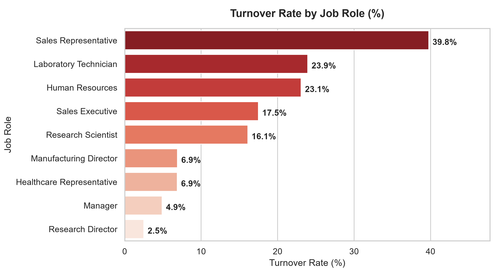
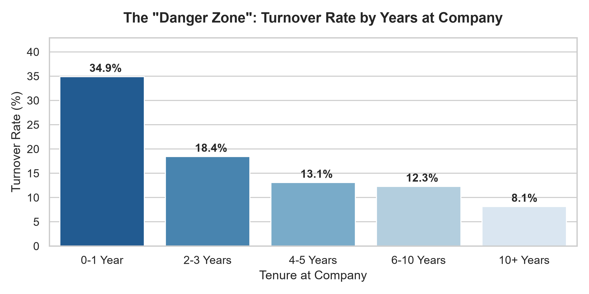
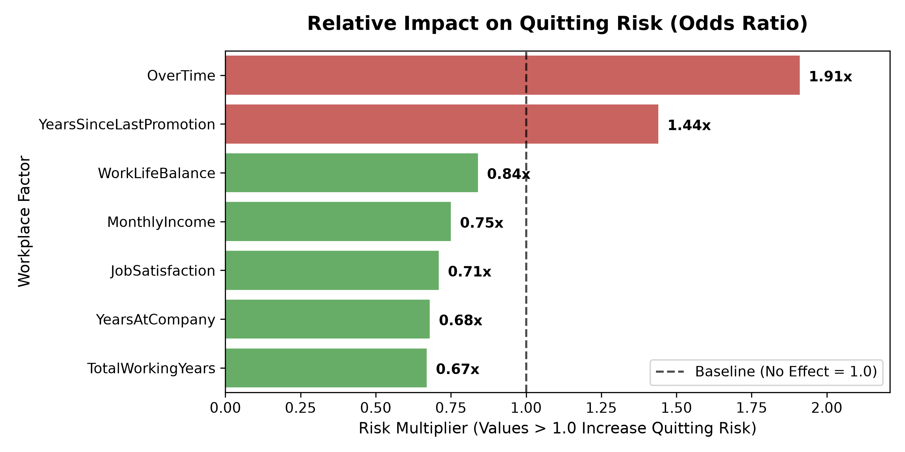

# 🏢 Employee Retention & Attrition Diagnostic
### Statistical Inference, Exploratory Analysis & Turnover Risk Modeling


---

## 📌 Executive Summary
Employee turnover carries significant financial and operational costs—replacing a salaried employee often costs between 50% to 150% of their annual salary. This project performs an end-to-end statistical diagnostic on workforce data (1,470 employees) to uncover **why employees leave**, **quantify risk factors**, and provide **actionable recommendations** for leadership.

### Key Business Findings:
1. **The Overtime Penalty:** Employees working overtime experience a **30.5% attrition rate** compared to just **10.4%** for standard hours. Chi-square testing confirmed this is statistically significant ($p < 0.001$).
2. **Compensation Gap:** Employees who voluntarily left earned an average of **~$1,500/month less** than peers who stayed. A two-sample t-test proved this difference is statistically significant ($p < 0.001$).
3. **The "Danger Zone" Tenure:** Attrition peaks sharply during the first **0–3 years** at the company (approaching 30%), before declining significantly after year 5.
4. **Top Risk Drivers:** Logistic regression odds ratios reveal that working overtime is the single largest controllable risk multiplier for quitting.

---

## 📊 Visual Highlights

### 1. The Impact of Overtime on Attrition
Employees working overtime leave at nearly **3x the rate** of those with normal work hours.


### 2. Turnover by Job Role & Seniority
Frontline, high-volume roles (e.g., Sales Representatives, Lab Technicians) exhibit the highest attrition, whereas leadership roles remain stable.



### 3. The Tenure "Danger Zone"
Attrition is concentrated in early tenure, indicating critical onboarding and mentorship gaps.



### 4. Turnover Drivers & Risk Multipliers (Odds Ratios)
Features with an Odds Ratio $> 1.0$ increase the probability of turnover; values $< 1.0$ serve as protective factors.



---

## 🔬 Statistical Hypothesis Testing

| Hypothesis | Test Applied | Metric / Stat | $p$-value | Conclusion |
| :--- | :--- | :--- | :--- | :--- |
| **Overtime vs. Churn** | Chi-Square Test of Independence ($\chi^2$) | $\chi^2 \approx 87.5$ | $p < 0.001$ | **Reject $H_0$:** Overtime has a statistically significant relationship with turnover. |
| **Compensation Gap** | Two-Sample Independent $t$-Test | $t \approx 6.0$ | $p < 0.001$ | **Reject $H_0$:** Salaries for departing staff are significantly lower than remaining peers. |

---

## 💡 Strategic Recommendations for HR & Leadership

* **Cap & Monitor Overtime Hours:** Institute automated burnout alerts when team members log consecutive weeks of overtime. Cross-train staff to absorb workload spikes.
* **Early-Career Mentorship (Years 1–3):** Re-structure the first-year employee journey with structured 6-month check-ins and accelerated learning pathways to curb the early-tenure cliff.
* **Targeted Market Compensation Reviews:** Conduct salary parity audits specifically for frontline roles (Sales Reps and Lab Technicians) to avoid losing high-demand talent to competitors for minor pay differentials.

---

## 📂 Repository Structure

```text
├── data/
│   ├── raw/                              <- Original unedited dataset
│   ├── processed/                        <- modified dataset
│   └── employee_attrition_cleaned.csv    <- Cleaned, transformed dataset
├── notebooks/
│   ├── exploratory_analysis.ipynb     <- Visualizations & pattern discovery
│   └── statistical_testing.ipynb      <- Chi-Square, T-Tests & Odds Ratio modeling
├── images/                               <- High-resolution plots used in README
├── README.md                             <- Project summary & business findings
└── requirements.txt                      <- Required Python dependencies
